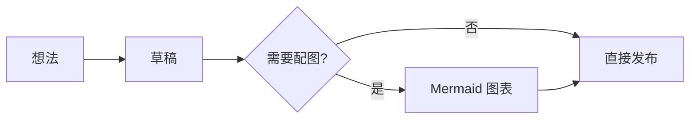

一份写给维刻 Vex 用户的 Markdown 参考：从标题、列表这些每天都要用的语法，到代码块、公式、Mermaid 图表，再到 Vex 特色的行内样式。每个知识点都配一段可以直接复制的源码——新建一篇文档，粘进去对照着看，比背语法表记得牢。

> 本文示例均以源码形式给出。把源码粘进 Vex 的即时渲染视图，就能看到对应效果；遇到拿不准的写法，也可以随时切到源码视图偷看一眼。

## 基础语法

### 标题与段落

井号的数量决定标题层级，从 `#` 到 `######` 共六级，一般把一级留给文章标题。段落之间空一行就会分段；想在段落内部换行，行尾补两个空格，或者按 `Shift + Enter`。

````md
# 一级标题（文章名）
## 二级标题（章节）
### 三级标题（小节）

这是一个段落，空一行开始新的段落。  
行尾两个空格（或 Shift+Enter）可以在段内换行，不会分成两段。
````

### 强调：加粗、斜体、删除线与高亮

星号成对使用：一对是斜体，两对是加粗，三对两者兼得。波浪线用来划掉反悔的内容。双等号是 Vex 的扩展语法，像荧光笔一样标记重点句。

````md
**加粗**、*斜体*、***粗斜体***
~~删除线~~
==高亮==（Vex 扩展，标记重点句）
````

前四种是所有 Markdown 阅读器都认识的老朋友，在 Vex 里长这样：**加粗**、*斜体*、***粗斜体***、~~删除线~~；`==高亮==` 则会被渲染成荧光笔底色。

### 上下标

化学式和幂运算不用再委屈成 H2O：一对波浪线包住下标，一对尖号包住上标。这也是 Vex 扩展语法，可以在 Markdown 偏好设置里按需开关。

````md
H~2~O、CO~2~、SO~4~^2-^
x^2^ + y^2^ = r^2^
米^3^、m/s^2^
````

在 Vex 中，它们会渲染成真正的 H₂O 与 x²；关闭该扩展后按原文显示，也不会把成对波浪线误认成删除线。

### 行内代码

反引号包住的内容保持原样，不参与任何 Markdown 解析，适合命令、文件名、快捷键和小段代码。

````md
按 `Ctrl + F` 打开查找，配置文件路径见 Vex 的快速开始文档。
````

按 `Ctrl + F` 打开查找。

### 引用

行首的 `> ` 把一段话变成引用，适合摘录与提醒，引用里还可以继续使用加粗、列表等其他语法。

````md
> 好的工具，让注意力回到内容本身。
````

> 好的工具，让注意力回到内容本身。

### 列表与任务列表

无序列表用 `-`，有序列表用 `1.`、`2.`，嵌套时缩进两个空格。任务列表在 `-` 后加 `[x]`（已完成）或 `[ ]`（待办），在 Vex 里可以直接点选勾框。

````md
- 梳理章节
  - 每章一个主题
- 收集素材

1. 先记下观察
2. 再整理线索
3. 最后成文

- [x] 写下一个值得记录的想法
- [x] 为文章梳理清晰的章节
- [ ] 留一点时间，重新阅读
````

现在就可以试试点选：

- [x] 写下一个值得记录的想法
- [ ] 留一点时间，重新阅读

### 分割线

单独一行的三个 `-` 或 `*` 是分割线，前后各留一个空行，用来给文章收住一个话题。

````md
上面的内容告一段落。

---

下面开始新的话题。
````

### 链接与图片

方括号写文字，圆括号放地址；图片在前面多一个感叹号。开启「自动链接」偏好后，裸网址也会被识别成链接。

````md
[维刻 Vex 官网](https://vex.codewf.com)

````

链接与图片既支持网络地址，也支持工作区内的相对路径，把截图和文档放在一起管理最省心。

## 表格

表头下面的一排短横线决定对齐方式：默认左对齐，两端加冒号居中，右侧加冒号右对齐。单元格用竖线分隔，不必刻意对齐源码里的竖线。

````md
| 语法 | 写法 | 用途 |
| :--- | :---: | ---: |
| 左对齐 | `:---` | 正文说明 |
| 居中 | `:---:` | 名称、状态 |
| 右对齐 | `---:` | 数字、金额 |
````

这张表本身就是用上面那段源码排出来的：

| 语法 | 写法 | 用途 |
| :--- | :---: | ---: |
| 左对齐 | `:---` | 正文说明 |
| 居中 | `:---:` | 名称、状态 |
| 右对齐 | `---:` | 数字、金额 |

## 代码块

三个反引号开头、单独一行收尾，开头一行写上语言名，Vex 就会给出语法高亮。代码块左上角显示语言类型，右上角提供下载、换行与复制三个按钮：下载把代码存成文件，换行让长行自动折行，复制一键拷贝全文。

````md
```python
# 用递归算斐波那契，演示注释与字符串
def fib(n: int) -> int:
    if n < 2:
        return n
    return fib(n - 1) + fib(n - 2)

print(f"fib(10) = {fib(10)}")
```
````

粘进 Vex 之后，它是这样的：

```python
# 用递归算斐波那契，演示注释与字符串
def fib(n: int) -> int:
    if n < 2:
        return n
    return fib(n - 1) + fib(n - 2)

print(f"fib(10) = {fib(10)}")
```

Python、JavaScript、C#、C++、JSON、Bash 这些常见语言都在支持之列。语言名可以省略，省略时按纯文本显示：

```csharp
// 异步统计非空行数，演示泛型与 await
public static async Task<int> CountAsync(IAsyncEnumerable<string> lines)
{
    var count = 0;
    await foreach (var line in lines)
    {
        if (!string.IsNullOrWhiteSpace(line)) count++;
    }
    return count;
}
```

## 数学公式与化学方程式

Vex 内置原生公式排版引擎（KaTeX 语法子集），不依赖网络与 CDN，写作、阅读与导出用的是同一套渲染。行内公式用一对 `$` 包住，独立成块的公式用两对 `$$`，也支持 `\(...\)` 与 `\[...\]` 的写法。

````md
圆的面积为 $A = \pi r^2$，质能关系为 $E = mc^2$。

$$
x = \frac{-b \pm \sqrt{b^2 - 4ac}}{2a}
$$
````

化学表达式交给 mhchem 扩展，在公式定界符里用 `\ce{...}` 书写，配平系数、气体符号与可逆反应都有现成写法：

````md
水 $\ce{H2O}$、硫酸根离子 $\ce{SO4^{2-}}$

$$
\ce{2H2 + O2 -> 2H2O}
$$

$$
\ce{N2 + 3H2 <=> 2NH3}
$$
````

两个贴心的小设定：写错的公式会保留源码显示，不会吞掉内容；导出 HTML、PDF、Word 时公式以图片形式嵌入，拿到任何设备上都能正常显示。数学与化学是两个独立开关，在偏好设置里按需启停。

## Mermaid 图表

把 `mermaid` 写在三反引号后面，代码块就成了图表。Vex 原生渲染 24 类 Mermaid 图表，随包图鉴包含流程图、时序图、甘特图、Venn 和 TreeView 等短示例。导出结果需按目标格式检查，屏幕渲染不能代替导出验收。

在阅读或即时编辑中单击图表，源码卡片会独立显示在图表上方并立即可输入；改完点击正文，提交修改并收起源码，阅读位置保持。源码视图也可以直接修改同一份 Mermaid 围栏代码。

````md

````

图表和正文一样参与即时渲染，改源码就改图，不必打开绘图软件。

## 行内样式（Vex 特色）

Markdown 管结构，不管颜色——但有时候，你就是想让那句话红一点、大一号。Vex 允许用行内 `<span style>` 给文字上样式，目前支持三个属性：

- `color`：文字颜色，例如 `#c92a2a`；
- `background-color`：背景色，例如 `#fff3bf`；
- `font-size`：字号（px），例如 `18px`。

### 动手设置

最省事的方式是选中文字：Vex 会弹出浮动工具条，直接调整字号、前景色与背景色；顶部工具条里也有字号与颜色按钮。设置结果以行内 `<span style>` 落盘到源码，所以直接手写这段 HTML 也完全可以。

### 源码与效果对照

````md
普通的<span style="color:#c92a2a">红色文字</span>、<span style="background-color:#fff3bf;color:#1b1f1e">浅黄底色</span>，也可以组合<span style="color:#1971c2;font-size:18px">蓝色大字</span>与<span style="font-size:12px">小号补充说明</span>。

样式还能叠着用：<span style="background-color:#ecf7ec;color:#30953b">绿底深绿的结论</span>、<span style="color:#6a3ac7;font-size:20px;background-color:#f3edf9">紫色大字垫浅紫底</span>，嵌在句中依旧随文排版。

<span style="font-size: 86px">想</span>法可以很大：把首字放大到 86px，行高自动撑开，其余文字流畅接排。
````

在本页（以及 Vex 的阅读视图）里，它们是这样的：

普通的<span style="color:#c92a2a">红色文字</span>、<span style="background-color:#fff3bf;color:#1b1f1e">浅黄底色</span>，也可以组合<span style="color:#1971c2;font-size:18px">蓝色大字</span>与<span style="font-size:12px">小号补充说明</span>。

样式还能叠着用：<span style="background-color:#ecf7ec;color:#30953b">绿底深绿的结论</span>、<span style="color:#6a3ac7;font-size:20px;background-color:#f3edf9">紫色大字垫浅紫底</span>，嵌在句中依旧随文排版。

<span style="font-size: 86px">想</span>法可以很大：把首字放大到 86px，行高自动撑开，其余文字流畅接排。

浅色底建议配一个深色文字（如上例的 `color:#1b1f1e`），在暗色主题下也清晰可读。

### 兼容性提醒

导出 HTML、PDF 与复制到公众号时，行内样式原样保留，排版效果不丢。但把文档发给只认纯 Markdown 的阅读器（GitHub、部分笔记软件）时，这些 `<span>` 标签会以原文显示。需要全平台通读的文档，重点强调优先用加粗与高亮，行内样式留给最终呈现的场合。

## 脚注与 Callout

脚注把解释性内容挪到页边，正文保持干净：正文里插入 `[^1]` 这样的记号，再在文档任意位置（通常文末）给出定义。Vex 会把编号渲染成可点击的上标，点击跳到注释，点注释旁的箭头再回到正文。

````md
Markdown 由约翰·格鲁伯创建[^1]，如今已是写作的通用底座。

[^1]: 2004 年发布于他的个人博客。
````

Callout 是引用的进阶形态：引用块的第一行写上 `[!INFO]` 或 `[!WARNING]`，Vex 会渲染成带图标的提示框，比普通引用更适合放注意事项与警告。

````md
> [!INFO]
> 这是一个信息提示框。

> [!WARNING]
> 这是一个警告提示框。
````

## 延伸阅读

本文覆盖的是日常写作够用的主干，更多细节与官方演示推荐按这个顺序读：

- [Markdown 功能示例](/docs/Markdown%E5%8A%9F%E8%83%BD%E7%A4%BA%E4%BE%8B/)：官方演示文档，列表层级、表格、Callout 与脚注的活例子；
- [快速开始](/docs/%E5%BF%AB%E9%80%9F%E5%BC%80%E5%A7%8B/)：安装 Vex、写下第一篇文档；
- [文档索引](/docs/)：全部文档的入口。

打开 Vex，新建一篇空白文档，把本文的示例挨个粘进去。语法不长在脑子里，长在手上。
